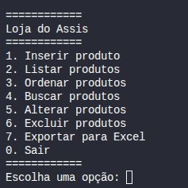
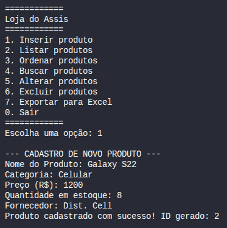
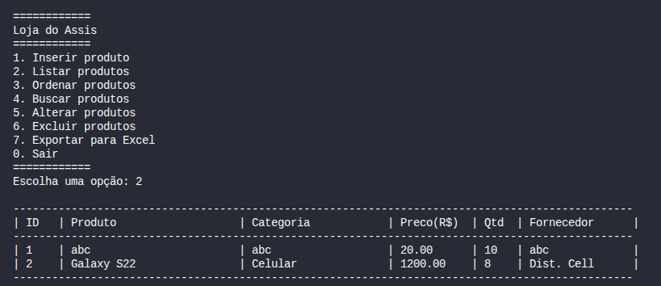
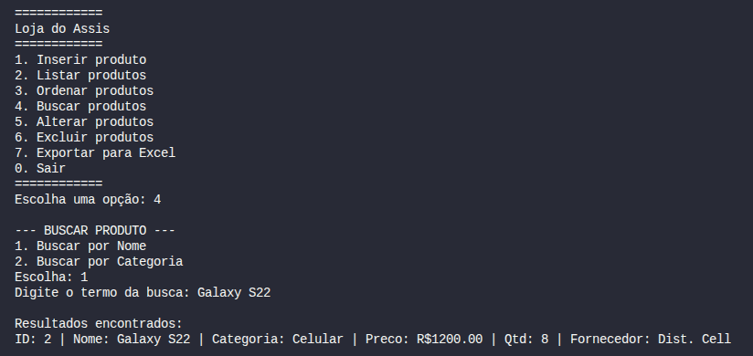
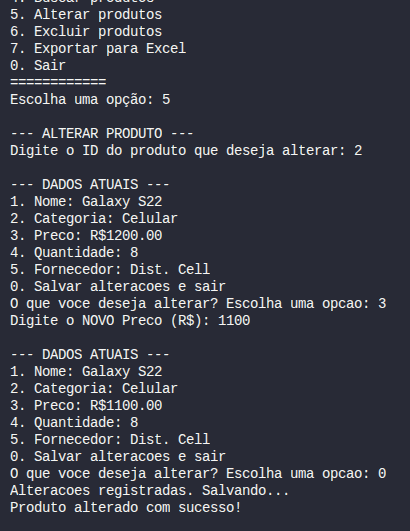
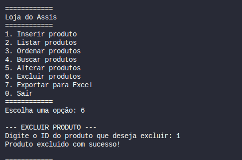
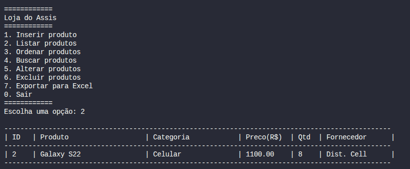
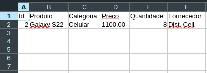

# SistemaLojaC

Sistema de gerenciamento de produtos em **linguagem C**, desenvolvido como atividade avaliativa em grupo da disciplina de **Algoritmos**, do curso de **Análise e Desenvolvimento de Sistemas (ADS) — UNICID**.

O projeto simula a administração de uma loja por meio do terminal, com cadastro de produtos, controle de estoque e persistência em arquivo de texto.

## Funcionalidades

- Cadastro de produtos com ID gerado automaticamente
- Verificação de nomes duplicados, sem diferenciar maiúsculas de minúsculas
- Listagem dos produtos em tabela
- Busca por nome e categoria
- Alteração de dados dos produtos por ID
- Exclusão de produtos por ID
- Ordenação por nome (A–Z e Z–A) e preço (crescente e decrescente)
- Exportação dos produtos para CSV, que pode ser aberto no Excel

## Demonstração

Capturas originais do programa, sem filtros, montagens ou molduras.

**Menu principal**



**Cadastro de produto**



**Listagem de produtos**



**Busca por nome**



**Alteração de produto**



**Exclusão de produto**



**Estoque atualizado**



**Exportação para CSV**



## Conteúdos aplicados

- Estruturas de dados com `struct`
- Funções, vetores e ponteiros
- Leitura e escrita em arquivos de texto
- Condicionais e estruturas de repetição
- `switch/case` para menus
- Ordenação com o algoritmo Bubble Sort

## Como executar

É necessário ter o compilador GCC instalado.

**Linux:**
```bash
gcc loja2.c -o loja
./loja
```

**Windows (PowerShell):**
```powershell
gcc loja2.c -o loja.exe
.\loja.exe
```

O sistema salva os dados em `loja.txt` e, quando solicitado, gera `loja.csv`.

## Estrutura do repositório

```text
SistemaLojaC/
|-- loja2.c
|-- README.md
|-- .gitignore
`-- imagens/
    |-- 01-menu.png
    |-- 02-cadastro.png
    |-- 03-listagem.png
    |-- 04-busca.png
    |-- 05-edicao.png
    |-- 06-exclusao.png
    |-- 07-estoque-atualizado.png
    `-- 08-exportacao-csv.png
```

## Integrantes

- Axel Castro
- Fabio Nogueira
- Guilherme Brito
- Giovanna Ayumi
- Rodrigo Silvestre

---

*Projeto acadêmico em grupo — ADS / UNICID, 2026.*
